1. De .cshtml a HTML. Explica qué le pasa a Surplus.cshtml desde que haces dotnet build hasta que el navegador recibe el HTML. | Compila con dotnet build -p:EmitCompilerGeneratedFiles=true, busca la clase generada para Status.cshtml y copia un WriteLiteral y un Write: ¿de qué parte de tu .cshtml sale cada uno? | ¿Por qué no hay ningún .cshtml dentro del contenedor? | ¿En qué ensamblado acaban las páginas, y en cuál acababan antes de .NET 6?

1
 Primero el dotnnet build transforma los cshtml en clases de c# y luego los compila junto  a los de cshtml.cs por que esos ya eran c#  despues razor busca con @page la pagina surplus se renderiza y eso es lo que se muestra en el navegador

2 
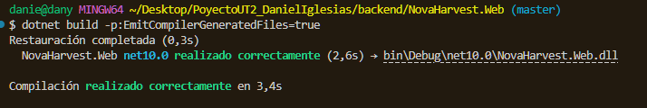

WriteLiteral("<h1>Estado del servidor</h1>\r\n
Fecha y hora del servidor: ");

sale del html fijo de Status.cshtml y el write Write(Model.ServerTime.ToString("dd/MM/yyyy HH:mm:ss") sale tambien de status.cshtml 

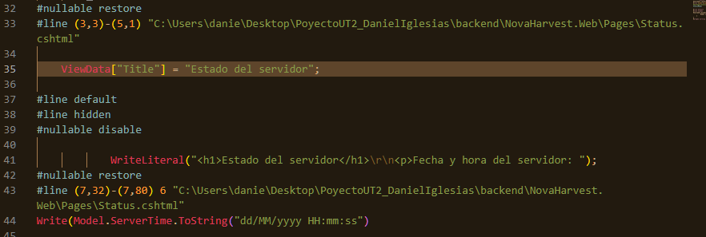

3
por que con build ya se convierten las clases en c# y se compilan y docker solo coge la salida del dll

4
segun lo que vi el ensablado va como parte del dll y lo de antes de .net 6 no se que tiene que ver pero no me entere solo entendi que se hacia aparte como en un archivo distinto

---

2. Tecnologías. Escribe la línea Precio de excedente: ... de tu página como se escribiría en PHP y en ASP clásico, y compárala con la tuya en Razor: ¿cómo marca cada una dónde empieza y dónde acaba el código? ¿Qué has ganado al pasar de los MapGet de UT2 a Razor Pages? Compara tu Program.cs de antes y de ahora. Añade también esa línea escrita en ERB (Ruby on Rails).

Precio de excedente: @Model.SurplusPrice.ToString("C") / kg
 esta es la linea

Precio de excedente: <?php echo number_format($surplusPrice, 2, ',', '.'); ?> € / kg
 asi seria en php

Precio de excedente: <%= FormatNumber(surplusPrice, 2) %> € / kg
 y asi en asp clasico

la direfenria principal que veo como empiezan el codigo  en razor empieza con @  yno tiene un cierre como tal en php <?php y termina ?>  y en asp <%= y termina ?> 

pues he conseguido un codigo mas limpio y mas facil de leer ademas de que si hay algun error si me va a marcar donde no como antes que el html se trataba como texto plano y es mas facil cambiar algo por que todo esta separado incluso del c#

y en ruby 
Precio de excedente: <%= number_with_precision(@surplus_price, precision: 2, separator: ",") %> € / kg
 es muy similar que al asp clasido con la diferencia de la sintasis

---

3. Etiquetas de código. Copia de tu proyecto un ejemplo de cada: expresión implícita, expresión explícita, bloque @{ }, @@ y comentario @* *@, junto con el HTML que genera cada uno (código fuente de la página). ¿Por qué info@novaharvest.es no necesita @@ y @novaharvest sí?

expresion implicita: <h2>@Model.Surplus.Product</h2> que convierte el html a Cereza Picota

expresion explicita: 
Nota del productor: @(Model.Surplus.Note ?? "Sin observaciones")
 que genera recoger antes de las 14 o urgente o un null

el bloque de @{} puede ser el del titulo  @{ ViewData["Title"] = "Acerca de"; }  el html generado es el titulo de la pestaña

 el @@ es cuando quieres poner un @ pero sin que sea codigo  por ejemplo la linea de 
Escríbenos a info@novaharvest.es o síguenos en @@novaharvest

 y @**@ no tengo ninguno pero se explicarlo son comentarios de c# que no llegan al cliente no son comentarios normales no generan ningun html ni nada 

 no necesita un doble @ por que esta puesta entre palabras y se entiende que es parte del texto no es lo mismo poner @user a digle@gmail.com por que como para usar codigo en c# se empieza con el arroba el sistema lo interpreta como tal y aunque haya algo que no existe lo pondra como error de compilacion o un warning no se exactamente

---

4. Sintaxis.

5.  Haz estos dos cambios en Surplus.cshtml (y deshazlos después): escribe @Model.SurplusPrize en lugar de @Model.SurplusPrice, y escribe @Model.Surplus.PricePerKg * 0.7m en alguna línea. Copia lo que ocurre en cada caso (el error de dotnet build o el HTML generado). ¿Por qué el primero no compila y el segundo sí, aunque el resultado esté mal? ¿Cómo se corrige el segundo?

en el primer cambio me sale error

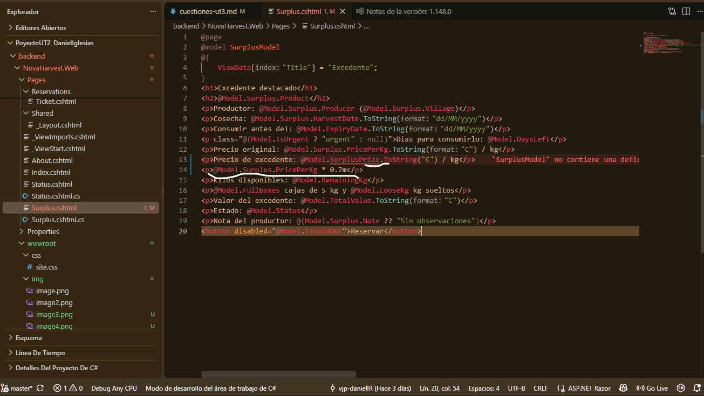

segundo

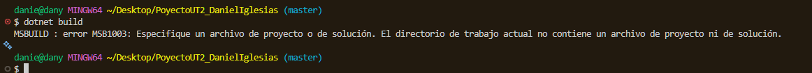

ya lo probe por separado no me habia dado cuenta de que no era todo junto basicamente el primero falla porque busca una propiedad que no existe por la z y si no encuentra el dato no puede compilar el segundo sí compila porque PricePerKg sí existe pero al haber un espacio antes del * razor corta ahí la expresión C# y deja * 0.7m como texto plano sin calcular la operación

---

5. Efectos en el documento. Compara cómo se ve la nota del productor en pantalla y en el código fuente de /surplus. ¿Qué ha hecho Razor y por qué? ¿Qué podría pasar si usaras @Html.Raw y la nota la escribiera un usuario malintencionado? Copia el elemento de los días y el botón en los escenarios A, C y D, y explica por qué a veces el atributo class o disabled no aparece. 

<!--Para el usuario malintencionado, pon como ejemplo una nota que redirija a otra web con window.location.-->

Caso A: 

codigo:

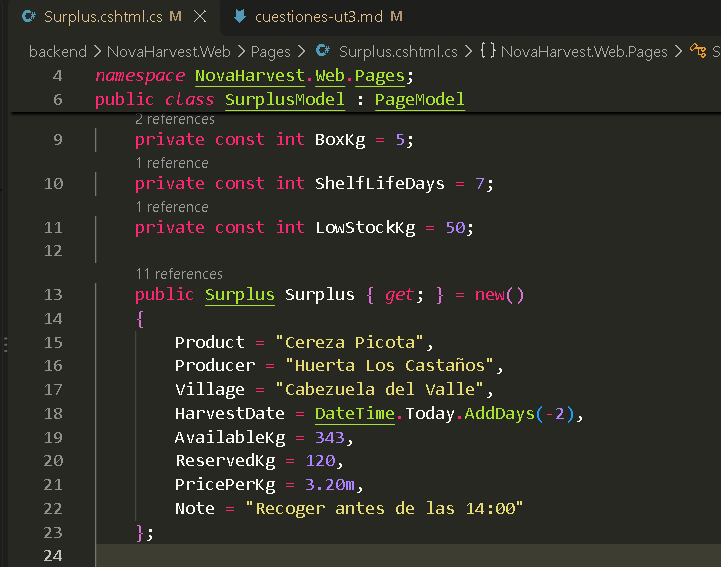

Demostracion:

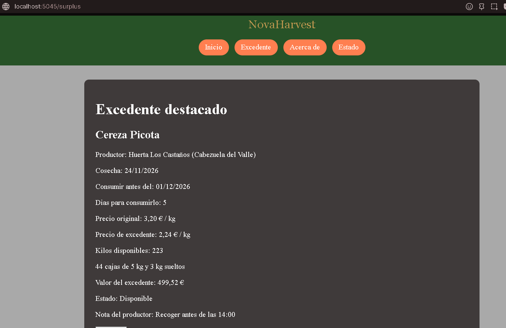

Caso C:

codigo:

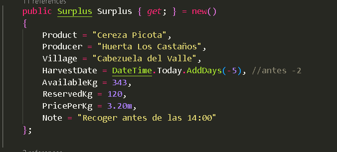

Demostracion:

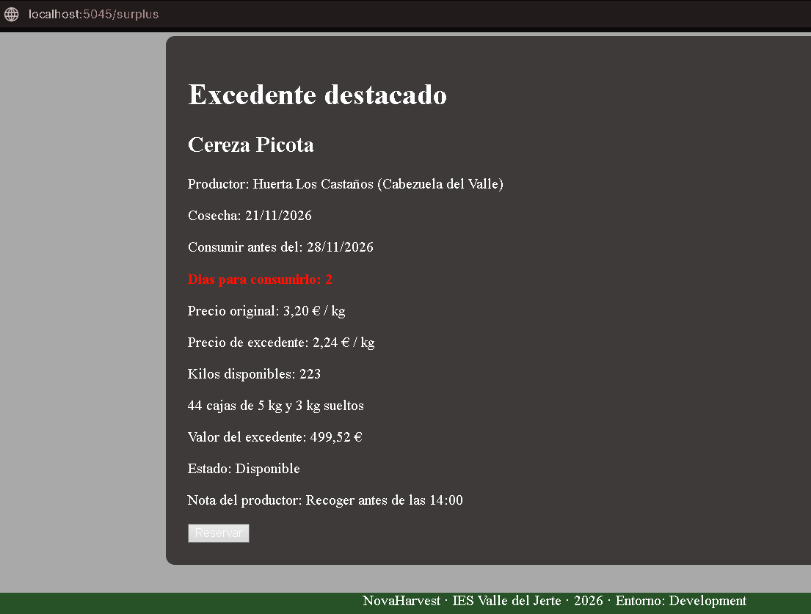

Caso D:

codigo:

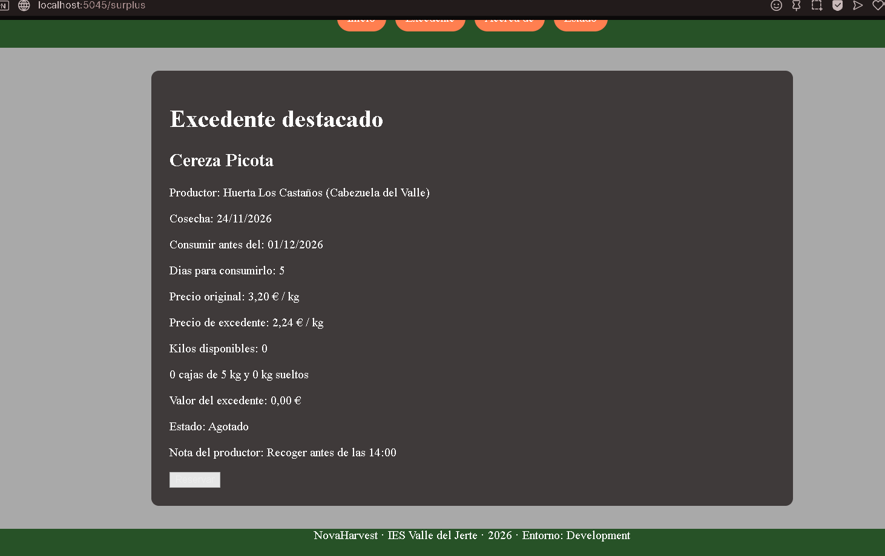

Demostracion:

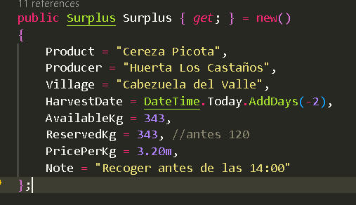

Si el valor es null o false Razor no pone el atributo por eso class solo sale cuando hay urgencia (caso C) y disabled solo cuando esta agotado (caso D)

---

1. Directivas. Haz una tabla con cada directiva o fichero especial de tu proyecto (@page, @page "/ticket", @model, @using, @namespace, @inject, _ViewStart.cshtml y Layout = null) y el comportamiento por defecto que cambia. Quita @namespace de _ViewImports.cshtml: copia el error y explícalo. ¿Por qué /reservations/ticket da 404?

| directiva         | que hace                                                                |
| ----------------- | ----------------------------------------------------------------------- |
| @page             | convierte el .cshtml en una pagina con url sin ella da 404              |
| @page "/ticket"   | cambia la url de la pagina a /ticket en vez de /reservations/ticket     |
| @model            | conecta la pagina con su PageModel para usar Model                      |
| @using            | importa NovaHarvest.Web.Models en todas las paginas                     |
| @namespace        | fija el namespace de las clases que genera razor                        |
| @inject           | pide el servicio IWebHostEnvironment para escribir el entorno en el pie |
| _ViewStart.cshtml | pone el layout a todas las paginas antes de mostrarlas                  |
| Layout = null     | quita el layout solo en ticket                                          |

codigo:

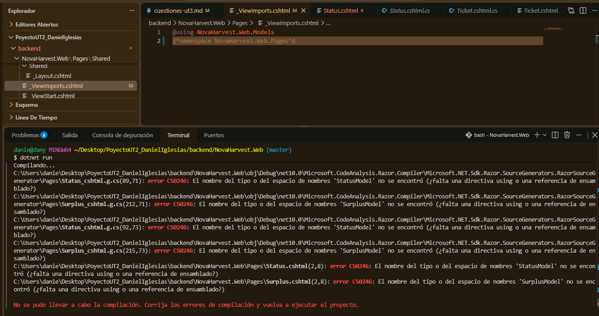

al quitar @namespace da el error CS0246: no encuentra StatusModel ni SurplusModel @namespace dice donde crea razor la clase de cada pagina sin el no puede compilar y como todo se compila a la vez si no encuentra algo no puede generar nada

---

7. Tipos y operadores. Haz una tabla con cada dato que calcula SurplusModel: su tipo de C#, los operadores que usa y por qué ese tipo. ¿Por qué RemainingKg / BoxKg da cajas completas? ¿Qué pasaría si los kilos fueran decimal? ¿Qué escribe Razor si muestras directamente un bool? ¿Y un null? Si los kilos fueran decimal, ¿cuántas cajas y kilos sueltos saldrían con 223,5 kg?

| dato         | tipo     | operadores               | por que ese tipo                       |
| ------------ | -------- | ------------------------ | -------------------------------------- |
| ExpiryDate   | DateTime | ninguno (usa AddDays)    | es una fecha                           |
| DaysLeft     | int      | -                        | son dias enteros, sin decimales        |
| SurplusPrice | decimal  | * y -                    | es dinero y decimal no pierde centimos |
| RemainingKg  | int      | -                        | los kilos son enteros                  |
| FullBoxes    | int      | /                        | las cajas son enteras                  |
| LooseKg      | int      | %                        | los kilos sueltos son enteros          |
| Status       | string   | < (en el else y else if) | es un texto                            |
| TotalValue   | decimal  | *                        | es dinero                              |
| IsSoldOut    | bool     | ==                       | solo hay dos opciones, agotado o no    |
| IsUrgent     | bool     | <=, > y &&               | solo hay dos opciones, urgente o no    |

en cuanto a por que remaininkg y boxkg dan cajas completas es por que dividimos enteros y los resultados tambien salen enteros por que se corta por que es un int aun que al final me queden 0,9 al ser int lo corta y se queda en 0 igual 

que pasaria si los kg fueran decimales pues que saldrian cajas a medias lo cual no es entregable con matices (como por ejemplo sea media pero se complete la otra media con otro producto del mismo tipo es decir si una caja traen 12 palmeras de crema pero yo no quiero tantas puedo pedir 5 de crema y otras 5 de otro sabor por lo menos eso si nos dejan hacer los proveedores de la tienda de mis padres y solo en productos determinados no en todos ) ese podria ser una opcion o la otra es que se sigan mandando cajas completas por que fullboxes es un int.

que escribe razor si muestras directamente un bool si muestro un bool directamente, razor escribe True o False con @Model.IsSoldOut sale True si no queda nada y False si queda algo en un atributo es distinto en el boton se usa disabled="@Model.IsSoldOut". si es true escribe disabled="disabled" y si es false no escribe nada

si fuera null razor no escribiria nada pero si es en un atributo el null desaparece

cuantas cajas y kilos sueltos saldrían con 223,5 kg pues es un calculo simple d 223,5 / 5 son 44,7 cajas quedarian sueltos 3,5 kg que son el 0,7 del resultado

---

8. Cultura. Quita UseRequestLocalization("es-ES") (y vuelve a ponerlo al terminar). Copia lo que muestran los precios de /surplus y la fecha de / con Docker y con dotnet run. Explica las diferencias y por qué esa línea las elimina.

dotnet run:

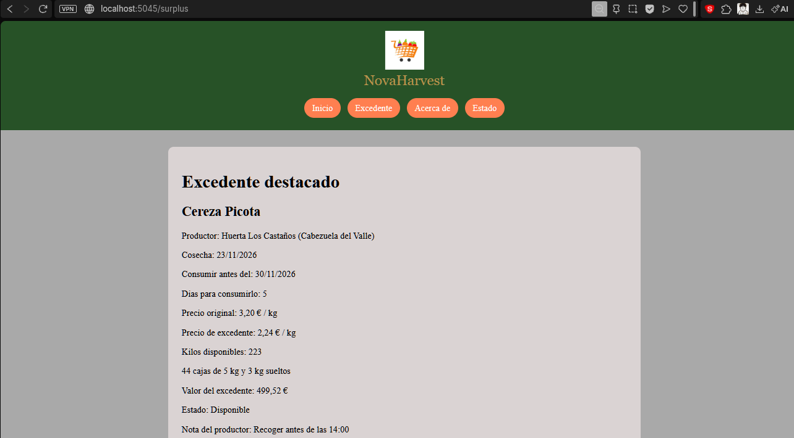

Docker:

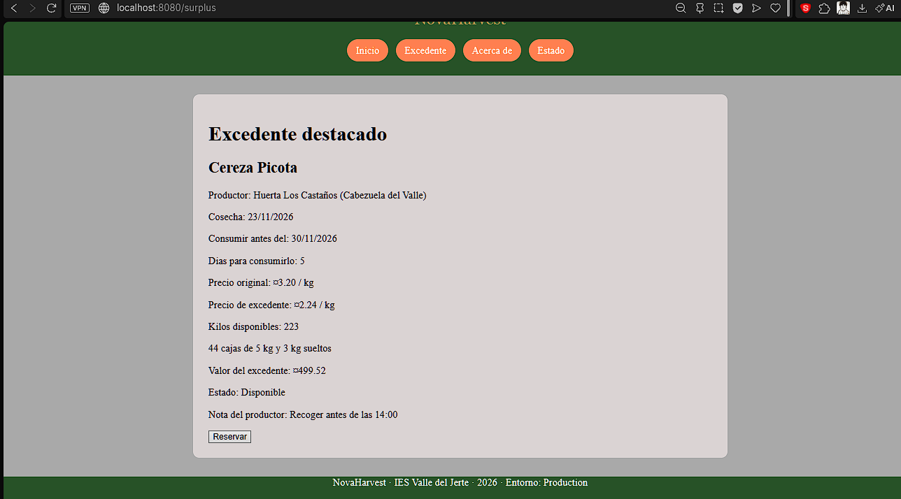

la diferencia esta en que dotnet run coge directamente la region del ordenador es decir que aunque hubieras estado en un pais con el ordenador configurado en la region de la libra hubiera salido asi lo hereda del sistema del equipo con el tiempo pasa lo mismo, aunque no le hice captura

con docker como va aislado de la maquina al ver un simbolo raro busque y vi que pueden pasar dos cosas 

1 que herede una cultura por defecto normalmente ingles de eeuu o 2 lo que ha pasado aqui, que usa por defecto una cultura invariante ¤ que es el simbolo generico de moneda con el tiempo lo pone en el idioma en el que este docker

---

9. Ámbito. Cambia temporalmente el contador de /status por una variable local en un @{ } de la página y recarga varias veces: ¿qué ves y por qué? Con SiteStats, ¿qué ve otro navegador, y qué pasa tras docker compose restart backend? ¿Por qué el layout no puede leer una variable declarada en Status.cshtml, y cómo le llega entonces el título?

con dotnet run:

Codigo modificado:

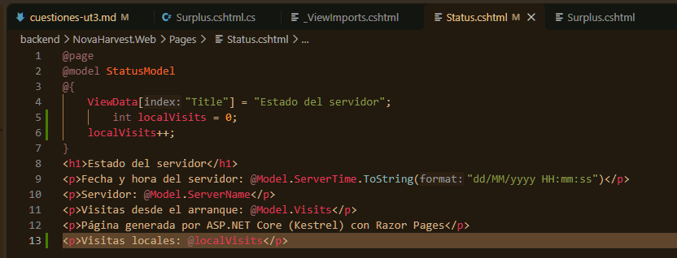

demostracion de uso:

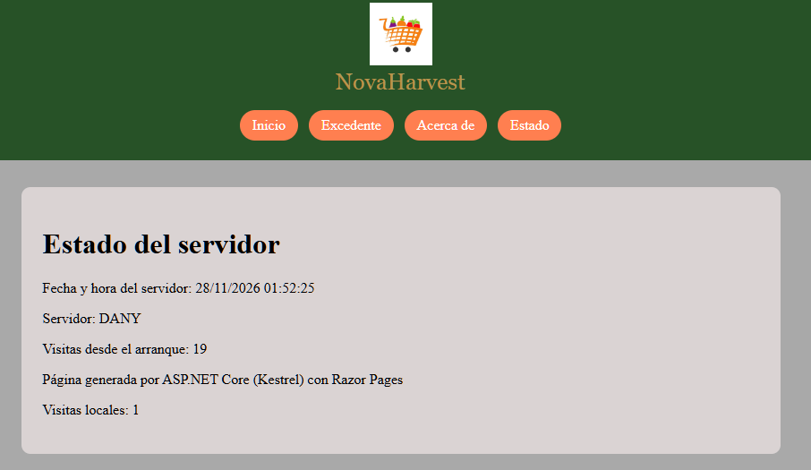

esto no suma por que siempre que se hace una peticion empieza desde 0

con docker:

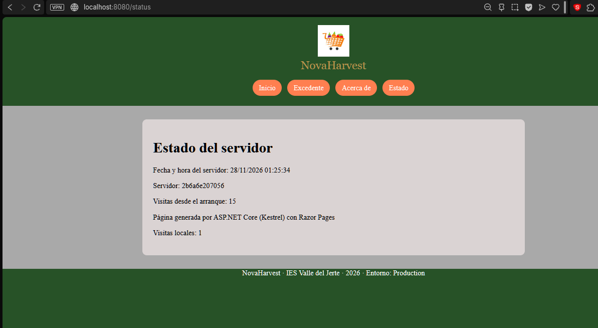

despues de reiniciar el backend

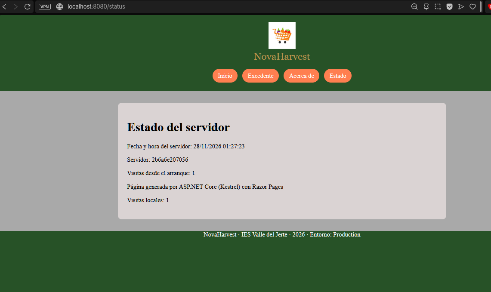

abri /status en otro navegador y el contador continuo donde iba, porque SiteStats.Visits es static: existe una sola vez y todos los visitantes suman al mismo numero tras docker compose restart backend el contador volvio a 1, porque al reiniciar se borra la memoria 

el layout no puede leer una variable declarada en Status.cshtml porque cada .cshtml se convierte en su propia clase, y una variable de un @{ } solo existe dentro de la clase de esa pagina el titulo le llega por ViewData: en Status.cshtml pongo ViewData[Title] = "Estado del servidor" y el layout lo lee con @ViewData["Title"] en el <title>

---

10.  PageModel. ¿Qué has puesto en SurplusModel y qué en Surplus.cshtml, y por qué? Cita un cálculo concreto. Si cargas /surplus tres veces, ¿cuántos objetos SurplusModel se crean y cuánto vive cada uno? ¿Y el contador de SiteStats?

en SurplusModel he puesto el excedente las constantes y los calculos y decisiones de OnGet() por ejemplo FullBoxes = RemainingKg / BoxKg en Surplus.cshtml solo muestro con @Model, por ejemplo @Model.FullBoxes sin calcular nada lo hago asi porque el enunciado pide que los calculos vayan en el PageModel y la pagina solo muestre

si cargo /surplus tres veces se crean 3 objetos SurplusModel uno por cada peticion cada uno vive solo lo que dura su peticion se crea ejecuta OnGet() se escribe el html y al terminar se descarta

el contador de SiteStats es static, asi que no se crean objetos: hay un unico SiteStats.Visits para toda la web vive mientras este arrancada y si cargo /status tres veces sube a 3 porque todos los StatusModel suman al mismo contador